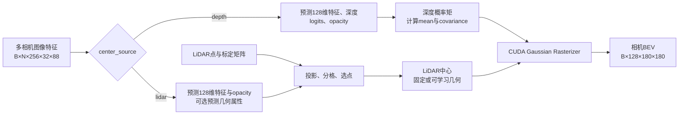

# GaussianBEVTransform 实现梳理

## 1. 作用与接入位置

`GaussianBEVTransform` 位于
`mmdet3d/models/vtransforms/gaussian_bev/`，用于将多相机图像特征组织成三维高斯，
再通过 CUDA Gaussian Splatting 得到相机 BEV 特征。它通过 `VTRANSFORMS` 注册，直接替换
DAOcc 相机编码器原有的 `BEVTransformV2`，不需要新增整体模型。

当前配置入口为：

```text
configs/nuscenes/occ3d/
└── daocc_occ3d_nus_w_mask_inin_spconv2_voxel_gaussian_bev_iter.yaml
```

注册链路为：

```text
mmdet3d/models/vtransforms/__init__.py
  → gaussian_bev/__init__.py
  → GaussianBEVTransform
```

## 2. 代码结构

| 文件 | 作用 |
|---|---|
| `transform.py` | 模块入口，选择高斯中心来源并串联预测、几何构建和渲染 |
| `predictor.py` | 从图像特征预测高斯特征和 opacity；按开关选择是否预测位置修正、尺度和旋转 |
| `geometry.py` | 按 GaussianLSS 的离散深度分布计算高斯中心和协方差 |
| `lidar_geometry.py` | 投影 LiDAR 点，选择每个图像特征格对应的点并构建高斯 |
| `renderer.py` | 调用 CUDA 光栅化器，将高斯聚合为 BEV 特征 |

整体流程如下：



## 3. 两种高斯中心来源

### 3.1 `center_source: lidar`（当前配置）

`PrepareLidarGaussianChannel` 将每个相机的 `256×32×88` 图像特征预测为：

- `feature`：每个特征格的128维高斯特征；
- `opacity`：经 sigmoid 后位于 `[0,1]` 的不透明度。

`LidarGaussianGeometry` 随后按 batch 逐样本处理不定长点云：

1. 用 `lidar2image` 和图像增强矩阵把 LiDAR 点投影到各相机；
2. 将图像坐标映射到 `32×88` 特征网格；
3. 每个相机特征格至多选择一个点；
4. 格内存在当前帧点时选择当前帧最近点，否则选择历史 sweep 最近点；
5. 使用选中格的图像 `feature` 和 `opacity`，以对应 LiDAR 点的增强坐标作为高斯中心；
6. 默认使用 `gaussian_std` 生成固定对角协方差；开启几何学习后，对中心、尺度和旋转进行修正。

不同 batch 样本的有效高斯数可以不同。实现先分别处理每个样本，再补齐至当前 batch 的
最大高斯数；补齐高斯的 opacity 为0，渲染前会被过滤。

### 3.2 `center_source: depth`

该模式保留 GaussianLSS 的基本做法。`PrepareChannel` 为每个图像特征格预测：

- 128维高斯特征；
- `depth_num` 个离散深度 logits；
- opacity。

`GaussianGeometry` 在 `[depth_start, depth_max]` 内建立均匀深度候选点，经过相机内外参和
数据增强变换到 LiDAR 坐标系。深度 logits 经 softmax 得到概率后：

- 概率加权一阶矩作为高斯中心；
- 概率加权二阶中心矩作为协方差；
- `error_tolerance` 对协方差整体缩放。

因此该模式每个相机特征格生成一个高斯，中心和协方差均由深度分布间接决定。

## 4. 高斯属性来源与可学习几何

| 属性 | LiDAR中心模式（默认） | LiDAR中心模式（开启几何学习） | 深度中心模式 |
|---|---|---|---|
| feature | 网络预测，128维 | 网络预测，128维 | 网络预测，128维 |
| opacity | 网络预测并经 sigmoid | 网络预测并经 sigmoid | 网络预测并经 sigmoid |
| mean | 选中的 LiDAR 点坐标 | LiDAR 点坐标加可学习位置修正 | 深度概率的一阶矩，间接可学习 |
| scale | 固定为 `gaussian_std` | 独立预测并限制在设定范围 | 无独立尺度头 |
| rotation | 固定单位四元数 | 独立预测并归一化为单位四元数 | 无独立旋转头 |
| covariance | 固定对角矩阵 | 由尺度和旋转计算 | 深度概率的二阶矩，间接可学习 |

当前 LiDAR 模式配置为：

```yaml
gaussian_std: [0.3, 0.3, 0.3]
learn_gaussian_geometry: false
gaussian_scale_min: [0.08, 0.08, 0.08]
gaussian_scale_max: [0.64, 0.64, 0.64]
center_offset_limit: [0.3, 0.3, 0.2]
```

`learn_gaussian_geometry: false` 为默认设置。此时不创建几何预测头，高斯尺度始终为
`[0.3,0.3,0.3] m`，旋转为单位四元数 `[1,0,0,0]`，位置修正为0，对应协方差为
`diag(0.09,0.09,0.09)`。

设置 `learn_gaussian_geometry: true` 后，共享几何分支从图像特征预测三组原始输出：

- 位置修正经 `tanh` 映射到 XYZ 分别为 `±0.3、±0.3、±0.2 m`；
- 尺度经 sigmoid 在对数空间映射到 `0.08～0.64 m`；
- 四维旋转残差与单位四元数相加后归一化，得到实际旋转四元数。

几何输出层采用定制初始化，使开启学习后的初始状态仍严格保持位置修正为0、尺度为0.3 m、
旋转为 `[1,0,0,0]`。因此新实验从固定几何版本的初始表示出发，再由任务损失学习调整。

## 5. 高斯到 BEV 的渲染

`GaussianBEVRenderer` 根据 `xbound/ybound` 构造 LiDAR XY 到 BEV 网格的 view 和 projection
矩阵。当前范围为 `[-54,54] m`、分辨率为 `0.6 m`，因此输出空间尺寸为 `180×180`。

渲染前先过滤 `opacity <= opacity_filter` 的高斯，然后逐 batch 样本调用：

```text
mmdet3d/ops/gaussian_rasterization
```

CUDA 光栅化器按高斯投影协方差确定约 `3σ` 的候选覆盖区域，并在每个 BEV 网格内执行
基于 opacity 的 alpha 合成，聚合其128维特征。最终输出形状为：

```text
[B, 128, 180, 180]
```

该输出继续进入原有 `ConvFuser`，与 LiDAR BEV 特征融合，后续 decoder 和任务头保持不变。

## 6. 当前实现的关键约束

- CUDA 光栅化器按128维特征编译，因此 `out_channels` 当前必须为128；
- 光栅化显式使用 FP32，即使外部训练启用了 AMP；
- LiDAR中心模式依赖输入 `points`、`lidar2image`、`img_aug_matrix` 和 `lidar_aug_matrix`；
- `opacity_filter` 是渲染前的硬过滤阈值，默认值为0.01；
- 当前实现只替换相机 view transform，不改变 LiDAR 编码、融合、decoder 和任务头。

## 7. 实验结果：固定几何 GaussianBEVTransform（11.22）

实验保持数据、图像与 LiDAR 编码器、融合层、任务头、batch size、学习率及训练预算一致，
只将相机分支的 `BEVTransformV2` 替换为 LiDAR 中心的 `GaussianBEVTransform`。该组实验
使用固定尺度0.3 m、单位旋转和零位置修正。

| 指标 | BEVTransformV2 | GaussianBEVTransform | 变化 |
|---|---:|---:|---:|
| 最终 OCC mIoU | 54.19 | **54.30** | **+0.11** |
| 最佳 OCC mIoU | 54.24 | **54.31** | **+0.07** |
| 最后4次验证平均 mIoU | 54.19 | **54.26** | **+0.07** |
| 最终检测 mAP | 59.51 | **60.39** | **+0.88** |
| 最佳检测 mAP | 60.13 | **61.11** | **+0.98** |
| 最终 NDS | **65.04** | 65.01 | -0.03 |

结果表明，固定几何 GaussianBEVTransform 已能达到与原 `BEVTransformV2` 相当的占据预测
性能，并对检测 mAP 有一定提升；NDS 基本持平。当前提升幅度较小，固定、各向同性的0.3 m
尺度无法根据目标大小、局部结构和投影误差调整覆盖范围，因此进一步引入可学习几何属性。

对应日志：

```text
BEVTransformV2:
/home/wangyushen/Data/Outputs/daocc/train/daocc/w_mask/
train_spconv2_voxel_iter_fp16_htc/20261111_231857.log.json

GaussianBEVTransform（固定几何）:
/home/wangyushen/Data/Outputs/daocc/train/daocc/w_mask/
train_spconv2_voxel_gaussian_bev_iter_fp16_htc/20261121_205717.log.json
```

## 8. 新改进：学习高斯尺度、旋转和位置修正（11.22）

固定几何版本中，所有高斯使用相同尺度和方向，且中心完全依赖离散 LiDAR 投影选点。
新版本保留 LiDAR 点提供的可靠初始中心，同时允许图像特征预测有限范围内的几何修正：

- 尺度学习不同方向上的覆盖范围，以表达局部结构大小和各向异性；
- 旋转学习椭球主轴方向，使各向异性尺度能够沿场景结构分布；
- 位置修正补偿 LiDAR 点采样稀疏、图像特征格量化以及标定和增强带来的局部误差。

对照实验仅增加以下启动参数，其余训练设置与固定几何实验一致：

```bash
--model.encoders.camera.vtransform.learn_gaussian_geometry true
```

实验输出目录：

```text
/home/wangyushen/Data/Outputs/daocc/train/daocc/w_mask/
train_spconv2_voxel_gaussian_bev_learn_geometry_iter_fp16_htc
```

该实验已完成，结果见第9节。学习后尺度、位置修正和旋转的分布尚未统计，仍需检查
尺度或位置修正是否大量贴近预设边界。

## 9. 三组实验占据预测结果对比（新增日期：2026-11-24）

### 9.1 对比口径与整体结果

对比原始 `BEVTransformV2`、LiDAR 中心固定几何 Gaussian、LiDAR 中心可学习几何
Gaussian 三组实验。三组日志均记录6个训练 epoch、24次验证；24次验证不等于24个 epoch。
保存配置中的 seed 均为0、每卡 batch size 为4、AdamW 初始学习率为 `2e-4`。
Gaussian 两组均使用 `center_source: lidar`，第三组开启中心偏移、尺度和旋转学习。
相机变换替换还伴随融合器相机输入通道适配，不应理解为整个网络结构完全不变。

下表 IoU 数值以百分数表示，差值为百分点。“最终”指日志最后一次验证，
“最佳”指各实验24次验证中的最高 OCC mIoU。

| 指标 | BEVTransformV2 | 固定几何 Gaussian | 可学习几何 Gaussian |
|---|---:|---:|---:|
| 最终 OCC mIoU | 54.19 | 54.30 | **54.53** |
| 最终值相对原基线增益 | — | +0.11 | **+0.34** |
| 最佳 OCC mIoU | 54.24 | 54.31 | **54.58** |
| 最后6次验证平均 mIoU | 54.12 | 54.21 | **54.44** |

可学习几何相对固定几何的最终提升为 **0.23** 个百分点；相对原基线提升 **0.34**。
三组最佳结果均出现在第23次验证。最后6次验证平均值也保持相同排序，表明观察到的
增益并非仅来自最后一个检查点，但目前每种设置只有一次运行，尚不能判断跨随机种子的稳定性。

### 9.2 全部占据类别 IoU

以下均为最后一次验证结果，两个 Δ 列均相对原始 `BEVTransformV2` 基线。

| OCC 类别 | BEVTransformV2 | 固定几何 Gaussian | Δ | 可学习几何 Gaussian | Δ |
|---|---:|---:|---:|---:|---:|
| others | 12.71 | **13.04** | +0.33 | 12.49 | -0.22 |
| barrier | 60.99 | **61.26** | +0.27 | 60.96 | -0.03 |
| bicycle | **40.05** | 38.84 | -1.21 | 38.68 | -1.37 |
| bus | 62.42 | **62.87** | +0.45 | 62.43 | +0.01 |
| car | 66.68 | 66.85 | +0.17 | **66.94** | +0.26 |
| construction_vehicle | 35.94 | 35.19 | -0.75 | **37.21** | +1.27 |
| motorcycle | **49.70** | 47.42 | -2.28 | 48.58 | -1.12 |
| pedestrian | **58.71** | 57.05 | -1.66 | 58.52 | -0.19 |
| traffic_cone | 45.36 | **47.70** | +2.34 | 47.18 | +1.82 |
| trailer | 49.60 | **50.92** | +1.32 | 50.90 | +1.30 |
| truck | 55.57 | 56.34 | +0.77 | **56.55** | +0.98 |
| driveable_surface | **82.87** | 82.60 | -0.27 | 82.83 | -0.04 |
| other_flat | 45.07 | 44.86 | -0.21 | **45.15** | +0.08 |
| sidewalk | 56.65 | 57.18 | +0.53 | **57.35** | +0.70 |
| terrain | 59.85 | **60.79** | +0.94 | 60.70 | +0.85 |
| manmade | 70.63 | 71.70 | +1.07 | **71.92** | +1.29 |
| vegetation | 68.38 | 68.49 | +0.11 | **68.65** | +0.27 |
| **mIoU** | **54.19** | **54.30** | **+0.11** | **54.53** | **+0.34** |

### 9.3 占据预测结果分析

**固定几何 Gaussian 的收益存在明显类别差异。** 相对原基线，交通锥提升2.34、
拖车提升1.32、manmade提升1.07；但摩托车下降2.28、行人下降1.66、自行车下降1.21。
因此，部分场景结构与目标类别的收益被另一些类别的损失抵消，最终 mIoU 仅提升0.11。
交通锥明显受益也说明，不能笼统归纳为“所有小目标都变差”。

**可学习几何改善了部分固定几何版本的弱项。** 相对固定几何，工程车辆提升2.02、
行人提升1.47、摩托车提升1.16，是本次新增收益最明显的类别。相对原基线，
工程车辆由下降0.75变为提升1.27，行人和摩托车的损失则分别缩小至0.19和1.12。
这与可学习覆盖范围及中心修正有助于局部特征分配的设想一致，但日志本身不能确定
具体收益来自中心、尺度还是旋转，需要分别关闭这些分支进行消融。

**可学习几何并未全面优于固定几何。** 自行车相对固定几何继续下降0.16，
交通锥下降0.52、others下降0.55、公交车下降0.44。最终自行车、摩托车和行人
仍未超过原始基线，说明当前几何学习尚未全面解决这些类别的表达问题。
固定尺度覆盖、投影选点、特征格分辨率和类别样本差异都可能影响结果，不能仅凭
这些 IoU 数值将原因确定为高斯平滑或某一种几何属性。

**静态场景结构的改善较连续。** 可学习几何相对原基线在 manmade、terrain、sidewalk、
vegetation 上分别提升1.29、0.85、0.70、0.27，driveable_surface基本持平（-0.04）。
总体收益来自目标类别与场景结构的共同变化，而不是所有类别一致提高。

### 9.4 检测结果参照与后续验证

| 最终检测指标（%） | BEVTransformV2 | 固定几何 Gaussian | 可学习几何 Gaussian |
|---|---:|---:|---:|
| mAP | 59.51 | **60.39** | 59.72 |
| NDS | **65.04** | 65.01 | 64.65 |

占据预测提升并未伴随检测指标全面提升，因此不能将本次 OCC 收益直接解释为
检测框质量提高。这三组实验也不是实例注入筛选策略的对照，不能据此推断 GT 几何筛选效果。

后续优先验证：分别开启中心修正、尺度和旋转，定位有效分支；检查学习后的几何参数分布；
对自行车、摩托车和行人分析漏检、边界扩散及类别混淆；补充不同随机种子的重复实验。

可学习几何实验日志（前两组日志见第7节）：

```text
/home/wangyushen/Data/Outputs/daocc/train/daocc/w_mask/train_spconv2_voxel_gaussian_bev_learn_geometry_iter_fp16_htc/20261122_221550.log.json
```
