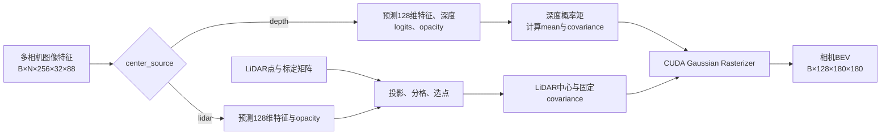

# GaussianBEVTransform 实现梳理

## 1. 作用与接入位置

`GaussianBEVTransform` 位于
`mmdet3d/models/vtransforms/gaussian_bev/`，用于将多相机图像特征组织成三维高斯，
再通过 CUDA Gaussian Splatting 得到相机 BEV 特征。它通过 `VTRANSFORMS` 注册，直接替换
DAOcc 相机编码器原有的 `BEVTransformV2`，不需要新增整体模型。

当前配置入口为：

```text
configs/nuscenes/occ3d/
└── daocc_occ3d_nus_w_mask_inin_spconv2_voxel_gaussian_bev_iter.yaml
```

注册链路为：

```text
mmdet3d/models/vtransforms/__init__.py
  → gaussian_bev/__init__.py
  → GaussianBEVTransform
```

## 2. 代码结构

| 文件 | 作用 |
|---|---|
| `transform.py` | 模块入口，选择高斯中心来源并串联预测、几何构建和渲染 |
| `predictor.py` | 从图像特征预测高斯特征、opacity，以及深度模式下的深度 logits |
| `geometry.py` | 按 GaussianLSS 的离散深度分布计算高斯中心和协方差 |
| `lidar_geometry.py` | 投影 LiDAR 点，选择每个图像特征格对应的点并构建高斯 |
| `renderer.py` | 调用 CUDA 光栅化器，将高斯聚合为 BEV 特征 |

整体流程如下：



## 3. 两种高斯中心来源

### 3.1 `center_source: lidar`（当前配置）

`PrepareLidarGaussianChannel` 将每个相机的 `256×32×88` 图像特征预测为：

- `feature`：每个特征格的128维高斯特征；
- `opacity`：经 sigmoid 后位于 `[0,1]` 的不透明度。

`LidarGaussianGeometry` 随后按 batch 逐样本处理不定长点云：

1. 用 `lidar2image` 和图像增强矩阵把 LiDAR 点投影到各相机；
2. 将图像坐标映射到 `32×88` 特征网格；
3. 每个相机特征格至多选择一个点；
4. 格内存在当前帧点时选择当前帧最近点，否则选择历史 sweep 最近点；
5. 使用选中格的图像 `feature` 和 `opacity`，以对应 LiDAR 点的增强坐标作为高斯中心；
6. 使用 `gaussian_std` 生成固定对角协方差。

不同 batch 样本的有效高斯数可以不同。实现先分别处理每个样本，再补齐至当前 batch 的
最大高斯数；补齐高斯的 opacity 为0，渲染前会被过滤。

### 3.2 `center_source: depth`

该模式保留 GaussianLSS 的基本做法。`PrepareChannel` 为每个图像特征格预测：

- 128维高斯特征；
- `depth_num` 个离散深度 logits；
- opacity。

`GaussianGeometry` 在 `[depth_start, depth_max]` 内建立均匀深度候选点，经过相机内外参和
数据增强变换到 LiDAR 坐标系。深度 logits 经 softmax 得到概率后：

- 概率加权一阶矩作为高斯中心；
- 概率加权二阶中心矩作为协方差；
- `error_tolerance` 对协方差整体缩放。

因此该模式每个相机特征格生成一个高斯，中心和协方差均由深度分布间接决定。

## 4. 高斯属性来源

| 属性 | LiDAR中心模式 | 深度中心模式 |
|---|---|---|
| feature | 网络预测，128维 | 网络预测，128维 |
| opacity | 网络预测并经 sigmoid | 网络预测并经 sigmoid |
| mean | 选中的 LiDAR 点坐标，固定 | 深度概率的一阶矩，间接可学习 |
| covariance | `gaussian_std²` 构成的固定对角矩阵 | 深度概率的二阶矩，间接可学习 |
| 独立尺度头 | 无 | 无 |
| 独立旋转头 | 无 | 无 |

当前 LiDAR 模式配置为：

```yaml
gaussian_std: [0.3, 0.3, 0.3]
```

对应协方差 `diag(0.09, 0.09, 0.09)`。固定协方差、view 和 projection 注册为
`persistent=False` buffer，由当前配置重新生成，不作为训练权重保存。

## 5. 高斯到 BEV 的渲染

`GaussianBEVRenderer` 根据 `xbound/ybound` 构造 LiDAR XY 到 BEV 网格的 view 和 projection
矩阵。当前范围为 `[-54,54] m`、分辨率为 `0.6 m`，因此输出空间尺寸为 `180×180`。

渲染前先过滤 `opacity <= opacity_filter` 的高斯，然后逐 batch 样本调用：

```text
mmdet3d/ops/gaussian_rasterization
```

CUDA 光栅化器按高斯投影协方差确定约 `3σ` 的候选覆盖区域，并在每个 BEV 网格内执行
基于 opacity 的 alpha 合成，聚合其128维特征。最终输出形状为：

```text
[B, 128, 180, 180]
```

该输出继续进入原有 `ConvFuser`，与 LiDAR BEV 特征融合，后续 decoder 和任务头保持不变。

## 6. 当前实现的关键约束

- CUDA 光栅化器按128维特征编译，因此 `out_channels` 当前必须为128；
- 光栅化显式使用 FP32，即使外部训练启用了 AMP；
- LiDAR中心模式依赖输入 `points`、`lidar2image`、`img_aug_matrix` 和 `lidar_aug_matrix`；
- `opacity_filter` 是渲染前的硬过滤阈值，默认值为0.01；
- 当前实现只替换相机 view transform，不改变 LiDAR 编码、融合、decoder 和任务头。
